# INSUREOPS AI
## Agentic Insurance Workflow Operating Layer

[](https://www.python.org/)
[](https://fastapi.tiangolo.com/)
[](https://react.dev/)
[](https://www.typescriptlang.org/)
[](https://github.com/kiru6006/insurance-operation-agent/actions/workflows/deploy-pages.yml)
[](https://kiru6006.github.io/insurance-operation-agent/)

> **InsureOps AI** is an enterprise agentic insurance workflow operating layer designed to sit between legacy core insurance platforms (Policy Administration, Claims Management, Billing, CRM) and front-line insurance workers. It ingests unstructured documents (ACORD forms, loss runs, FNOL notices, police reports, endorsements), automates multi-step cross-system verification, enforces three-tier autonomy governance, prepares human decision packages, and maintains an immutable audit trail.

---

## 🌐 Live Demo & GitHub Pages

Try the live application hosted directly on GitHub Pages with built-in client-side mock backend execution:
👉 **[https://kiru6006.github.io/insurance-operation-agent/](https://kiru6006.github.io/insurance-operation-agent/)**

- **Pre-configured Accounts:** `demo` / `demo` or `admin` / `admin`
- Full interactive triage across Commercial Submissions, First Notice of Loss Claims, Policy Servicing, Knowledge Base RAG, and Agent Control Plane.

---

## Architecture Overview

```mermaid
flowchart TB
    subgraph UI ["Frontend (React 18 + Vite + TailwindCSS)"]
        Dashboard["Operations Dashboard & ROI Benchmarks"]
        SubmissionsUI["Commercial Underwriting Dossier"]
        ClaimsUI["Claims Adjudication Workspace"]
        PolicyServicingUI["Policy Servicing Workspace"]
        KnowledgeUI["RAG Knowledge Workspace"]
        ControlPlaneUI["Agent Control Plane & Observability"]
        ApprovalsUI["Human-in-the-Loop Inbox"]
    end

    subgraph API ["FastAPI Backend (REST API)"]
        AuthRoute["/api/v1/auth"]
        SubmissionsRoute["/api/v1/submissions"]
        ClaimsRoute["/api/v1/claims"]
        PolicyServiceRoute["/api/v1/policy-service"]
        KnowledgeRoute["/api/v1/knowledge"]
        AgentsRoute["/api/v1/agents"]
        ApprovalsRoute["/api/v1/approvals"]
        DashboardRoute["/api/v1/dashboard"]
    end

    subgraph Orchestration ["Workflow Engine & Agent Control Plane"]
        UnderwritingWorkflow["Commercial Underwriting Workflow Engine"]
        ClaimsWorkflow["Claims Adjudication Workflow Engine"]
        PolicyServiceWorkflow["Policy Servicing Workflow Engine"]
        Governance["3-Tier Autonomy Governance (Assist, Recommend, Execute)"]
        AuditService["Immutable Audit Trail & Telemetry Logger"]
    end

    subgraph Agents ["Domain-Specialized Insurance Agents"]
        Agent1["Commercial Intake & ACORD Extraction Agent"]
        Agent2["Completeness & Missing Information Agent"]
        Agent3["Risk Assessment & Appetite Summary Agent"]
        Agent4["Claims Intake & FNOL Extraction Agent"]
        Agent5["Coverage & Policy Validation Agent"]
        Agent6["Fraud & Duplicate Detection Agent"]
        Agent7["Policy Servicing Intent & Eligibility Agent"]
    end

    subgraph Storage ["Enterprise Persistence & RAG Engine"]
        Postgres[(PostgreSQL / SQLite Database)]
        RAGChunks[(Semantic Vector & Keyword Chunk Index)]
        AuditDB[(Immutable Event Log)]
    end

    subgraph MockSystems ["Core Insurance Adapters (Mock / Extensible)"]
        PolicySys["Policy Administration System (PAS)"]
        ClaimsSys["Claims Management System (CMS)"]
        CRMSys["Broker & Customer CRM"]
        BillingSys["Billing & Accounting System"]
    end

    UI --> API
    API --> Orchestration
    Orchestration --> Agents
    Orchestration --> Storage
    Agents --> Storage
    Agents --> MockSystems
```



---

## 3 Core MVP Workflows Implemented

### 1. Commercial Insurance Submission → Underwriting Decision Preparation
- **Intake & ACORD Document Parsing:** Parses ACORD 125/126 applications, extracting insured profile, effective dates, coverages requested, and operations.
- **Completeness & Audit Engine:** Audits submission against underwriting requirements, calculates completeness score (0-100%), and flags missing documents (e.g., loss runs, financial statements, safety manuals).
- **Risk & Appetite Assessment:** Evaluates ISO industry codes (e.g., HVAC manufacturing, commercial roofing), checks carrier eligibility thresholds, and generates an underwriter executive summary.
- **Human Approval & Underwriter Dossier:** Routes high-risk submissions to Underwriting Leads for formal quote/decline sign-off.

### 2. First Notice of Loss (FNOL) → Claims Adjudication
- **FNOL Ingestion:** Ingests unstructured emails, loss reports, and repair estimates across Auto, Property, and General Liability.
- **Policy & Coverage Validation:** Cross-references policy status, incident dates, loss types, and applicable deductibles against core records.
- **Fraud & Duplicate Detection:** Computes fraud risk scores based on same-day reporting anomalies, historical claim frequency, and suspicious loss descriptions.
- **Adjuster Decision Package & Autonomy Routing:**
  - *Fast-Track (Straight-Through):* Low severity, zero fraud signals auto-approved up to policy thresholds.
  - *Human Review:* High severity (> $10,000) or flagged fraud automatically escalated to senior adjusters.

### 3. Policy Servicing & Endorsement Requests
- **Intent Recognition:** Categorizes policyholder requests into Address Changes, Named Insured Modifications, Vehicle Additions/Removals, Coverage Limit Adjustments, and Certificates of Insurance (COI).
- **Three-Tier Autonomy Governance:**
  - **Level 1 (Assist):** Complex coverage rider modifications; AI prepares evidence, human decides.
  - **Level 2 (Recommend):** Vehicle additions; AI validates eligibility and recommends endorsement, human approves.
  - **Level 3 (Execute):** Deterministic requests (e.g., Address Change, COI issuance); executed straight-through automatically.
- **Core System Updates & Audit:** Directly updates mock policy administration records and registers full audit records with diffs.

---

## Advanced Capabilities

### Enterprise RAG & Knowledge Base
- Ingestion of underwriting guidelines, policy wordings, reinsurance treaties, and state statutory rules.
- Fast semantic vector and keyword retrieval with source document attribution and confidence scores.
- Interactive RAG query interface in frontend with citation drilldown.

### Agent Control Plane & Observability
- Canonical agent registry for all 7 domain agents.
- Real-time monitoring of agent execution latency, autonomy tiers, tool invocation permissions, and accuracy/completeness evaluation scores.
- Trace inspection with step-by-step reasoning tokens, inputs, and outputs.

### Operations Intelligence & Automation Benchmarks
- Automated quantification of manual work eliminated:
  - **Before InsureOps AI:** 14-18 manual touches per submission, 4.5 days average turnaround.
  - **After InsureOps AI:** 2 manual touches, < 4 hours turnaround (75-80% manual step reduction).
- Real-time metrics on dashboard reflecting live database counts, automation rates, and cost savings.

---

## Directory Structure

```text
insurance-operation-agent/
├── .github/workflows/                 # Automated CI/CD
│   └── deploy-pages.yml               # GitHub Actions deployment to GitHub Pages
├── .env.example                       # Reference environment variables
├── .gitignore                          # Git ignore rules for Python, Node, & DB
├── docker-compose.yml                  # PostgreSQL, Redis, Backend & Frontend containers
├── Dockerfile.backend                  # Python 3.12 FastAPI container definition
├── Dockerfile.frontend                 # Node 20 Vite React container definition
├── Makefile                            # Developer task shortcuts (up, down, test, run-local)
├── Plan.md                             # Architectural specification & product principles
├── README.md                           # Build system, phase guidelines & documentation
│
├── backend/                            # FastAPI Application Root
│   ├── requirements.txt                # Python dependencies
│   ├── alembic.ini                     # Database migration configuration
│   ├── alembic/                        # Alembic database migrations
│   │   ├── env.py                      # DB URL & metadata config for Alembic
│   │   └── versions/                   # Versioned SQL migrations
│   ├── agents/                         # Agent Implementations
│   │   ├── underwriting/               # Underwriting agents (intake, completeness, risk)
│   │   ├── claims/                     # Claims agents (intake, validation, fraud)
│   │   └── policy_service/             # Policy servicing agents (intent, eligibility, execution)
│   ├── app/
│   │   ├── main.py                     # FastAPI entrypoint, middleware, routers
│   │   ├── core/                       # Core configuration (config, db, security, deps)
│   │   ├── models/                     # SQLAlchemy ORM models (Submission, Claim, Policy, etc.)
│   │   ├── repositories/               # Data access repository layer
│   │   ├── schemas/                    # Pydantic request/response validation schemas
│   │   ├── services/                   # Business logic & workflow orchestrator
│   │   ├── infrastructure/             # Mock external insurance systems & tool adapter
│   │   └── api/routes/                 # REST API endpoints (auth, submissions, claims, etc.)
│   └── tests/                          # Pytest automated test suite (22 comprehensive tests)
│
└── frontend/                           # React + Vite + TypeScript Frontend
    ├── package.json                    # Node dependencies & scripts
    ├── vite.config.ts                  # Vite configuration & backend proxy
    ├── tsconfig.json                   # TypeScript compiler options
    ├── tailwind.config.js              # Tailwind CSS configuration
    └── src/
        ├── main.tsx                    # React DOM entry
        ├── App.tsx                     # Route definitions (HashRouter for GitHub Pages)
        ├── services/                   # Frontend API services & MockStatic fallback
        ├── components/                 # Reusable UI components & layouts
        └── pages/                      # Domain views (Dashboard, Submissions, Claims, etc.)
```

---

## 🚀 Running Locally

### Option A: One-Command Local Run (Make)
```bash
make run-local
```
This concurrently boots:
- Backend at `http://localhost:8000` (Docs: `http://localhost:8000/docs`)
- Frontend at `http://localhost:5173`

---

### Option B: Manual Setup

#### 1. Start Backend
```bash
cd backend
source venv/bin/activate
pip install -r requirements.txt
cp ../.env.example .env

# Initialize database schema
python -c "from app.core.db import engine, Base; from app.models import *; Base.metadata.create_all(bind=engine)"

# Start FastAPI server
PYTHONPATH=. uvicorn app.main:app --host 0.0.0.0 --port 8000 --reload
```

#### 2. Start Frontend
```bash
cd frontend
npm install
npm run dev
```
Open `http://localhost:5173` in your browser.

---

## 📦 Deploying to GitHub Pages

The repository contains an automated GitHub Actions deployment workflow at [`.github/workflows/deploy-pages.yml`](file:///.github/workflows/deploy-pages.yml).

### To Enable GitHub Pages on your repository:
1. Navigate to your repository settings on GitHub:
   `https://github.com/kiru6006/insurance-operation-agent/settings/pages`
2. Under **Build and deployment** > **Source**, choose **GitHub Actions**.
3. Push to `main` (or run the workflow manually from the **Actions** tab).
4. Your site will be published at:
   `https://kiru6006.github.io/insurance-operation-agent/`

---

## Demo Credentials

The database is pre-seeded with role-based access control accounts:

| Role | Username | Password | Access Scope |
| :--- | :--- | :--- | :--- |
| **Admin / Underwriting Lead** | `admin` | `admin` | Full system access, agent configuration, approvals |
| **Operator / Adjuster** | `demo` | `demo` | Submissions, Claims, Policy Servicing, Knowledge Base |
| **Underwriter** | `underwriter` | `underwriter123` | Underwriting queue, risk evaluations, approvals |

---

## Running Automated Tests

Run the backend test suite:
```bash
cd backend
PYTHONPATH=. venv/bin/pytest tests/ -v
```
All **28 tests** pass.

Run the frontend TypeScript build:
```bash
cd frontend
npm run build
```
Production bundle compiles cleanly with 0 errors.

---

## Containerized Deployment (Docker)

```bash
docker compose up --build
```
- Frontend: `http://localhost:3000`
- Backend API: `http://localhost:8000`
- API Documentation: `http://localhost:8000/docs`